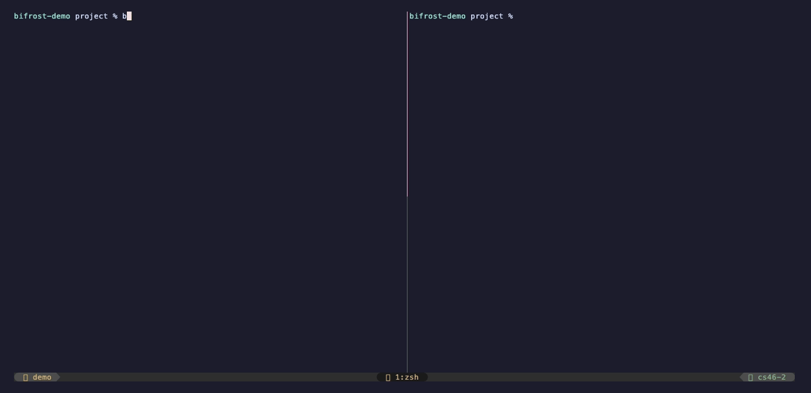

# Bifrost

[](https://github.com/kogungor/bifrost/actions/workflows/ci.yml)
[](https://goreportcard.com/report/github.com/kogungor/bifrost)
[](LICENSE)

> Hand off AI coding work between Claude Code, Codex, and OpenCode, and tell the next agent which claims were actually verified.



## Why

When a session runs out of context or you switch tools, the next agent starts cold. You explain the task, the decisions, and the half-finished work again.

A pasted summary has a second problem: it mixes facts with claims. "Tests pass" might mean the previous agent ran them, or only that it expects them to pass. A file it says it edited may have changed since.

Bifrost writes a structured handoff and checks it against the repository before the next agent relies on it. What Bifrost observed itself (git state, file metadata, commands it ran) is kept apart from what the previous agent reported, and the briefing says which is which.

## How It Works

```
Claude Code                                  Codex / OpenCode / new session
/handoff ──▶ .bifrost/session.json ──▶ /handin --verify
             .bifrost/evidence/            ($bifrost-handin --verify in Codex)
```

1. **`/handoff`**: the agent records the task, status, decisions, assumptions, risks, active files, and next step. Bifrost adds git and file facts, attaches evidence, and redacts secret-like values.
2. **`/handin --verify`**: the next agent runs `bifrost verify`, which checks branch and commit drift, changed active files, evidence behind status claims, unresolved high-severity risks, and plan state.
3. The agent presents a briefing with **Trust this**, **Verify this first**, and **Do not assume**, then waits for your go-ahead.

## Example

Output of `bifrost brief` after a Claude Code handoff, with `src/tokens.go` edited afterwards (trimmed):

```
Verification summary
- Status     warn
- Safe next  Run `git status --short` and inspect changed active files.

Verify this first
- Active files changed after snapshot: src/tokens.go. Next: Inspect changed files before continuing.
- 3 status claim(s) lack evidence. Next: Treat unevidenced status as model interpretation, not repo fact.
- Test-pass evidence was reported by the previous agent, not observed by Bifrost. Next: Re-run the tests, or `bifrost plan verify`, before trusting the claim.

Do not assume
- Do not assume active files are unchanged.
- Do not assume model claims are evidence-backed.

Active files
- src/auth.go - middleware wired, refresh path stubbed [implementation=medium, tests=low, freshness=current, evidence=strong]
- src/tokens.go - rotation logic half done [implementation=low, tests=low, freshness=stale, evidence=strong]
```

## Install

```bash
brew install --cask kogungor/bifrost/bifrost
```

Use the full name: plain `brew install --cask bifrost` installs an unrelated app from Homebrew's main cask repository, even after `brew tap kogungor/bifrost`. If you did that, run `brew uninstall --cask bifrost` first.

Or `curl -fsSL https://raw.githubusercontent.com/kogungor/bifrost/dev/install.sh | sh`, or download a binary from [GitHub Releases](https://github.com/kogungor/bifrost/releases).

Then register the commands and the MCP server for every tool Bifrost detects, set up each project once, and check the result:

```bash
bifrost install --mcp
cd your-project && bifrost init
bifrost doctor
```

Restart your AI tools afterwards so they load the new commands.

| Tool        | Hand off           | Hand in                    | MCP server registered in           |
| ----------- | ------------------ | -------------------------- | ---------------------------------- |
| Claude Code | `/handoff`         | `/handin --verify`         | `~/.claude.json`                   |
| OpenCode    | `/handoff`         | `/handin --verify`         | `~/.config/opencode/opencode.json` |
| Codex       | `$bifrost-handoff` | `$bifrost-handin --verify` | `~/.codex/config.toml`             |

Without `--mcp`, `/handoff` and `/handin` fall back to reading and writing `.bifrost/session.md` directly; `/plan` and `/review` need the MCP server.

**Upgrading.** `brew upgrade --cask kogungor/bifrost/bifrost`, then `bifrost install --mcp --force` (add `--hooks` if you use them) so your tools get the new command files; `install` alone keeps existing files. Versions 1.3.x and earlier wrote MCP config where Claude Code and OpenCode never read it; `bifrost doctor` finds those old files.

## Usage

In the tool you are leaving, optionally with a note:

```
/handoff auth half done, pick up with the refresh token tests
```

In the tool you are switching to:

```
/handin --verify
```

From a terminal:

```bash
bifrost verify                 # drift, changed files, evidence, risks, secrets
bifrost brief --mode review    # compact briefing: implement, debug, review, plan, or handoff
bifrost diff                   # what changed since the previous snapshot
```

**Automatic handoff (Claude Code).** `bifrost install --hooks` registers Claude Code hooks. Before a compaction and when a session ends, Bifrost records the commands the agent actually ran, with the exit codes from Claude Code's own transcript, and the files it edited. The compaction summary is kept as the handoff note, and a resumed or compacted session starts with the briefing. If no `/handoff` was written, an automatic snapshot holds the observed facts. Hooks act only in projects that already use Bifrost.

**Plans across tools.** `/plan <name>` in one tool writes a structured plan; `/review <name>` in another critiques it and approves it or sends it back. `bifrost plan status <name>` and `bifrost plan next <name>` show progress from a terminal. Each step can carry verification commands, such as the tests that cover it; `/plan` proposes them and `/review` checks them. `bifrost plan verify <name>` shows them, asks before running them, and marks passing steps `verified_done`.

The [reference](docs/reference.md) covers every command, flag, file, and MCP tool.

## Trust Model

| Source                                     | Example                                                     | Counts as                 |
| ------------------------------------------ | ----------------------------------------------------------- | ------------------------- |
| Observed by Bifrost (`collector.*`)        | branch, commit, file metadata, `bifrost plan verify` results | strong evidence           |
| Reported by the agent (`reported.command`) | "ran `go test ./...`, exit 0"                               | medium: a detailed claim  |
| Recorded by the harness (`collector.transcript`) | exit codes from the Claude Code transcript, via `--hooks` | strong evidence           |
| Model claim                                | "[x] validateToken() implemented" with nothing behind it    | not evidence              |

MCP callers cannot label their own evidence as `collector.*`.

## Supported Tools

| Tool        | Status                      |
| ----------- | --------------------------- |
| Claude Code | Supported                   |
| OpenCode    | Supported                   |
| Codex       | Supported (as Agent Skills) |
| Cursor      | Planned                     |
| Gemini CLI  | Planned                     |

A new tool needs one adapter file; see [CONTRIBUTING.md](CONTRIBUTING.md#adding-a-new-adapter).

## Security And Privacy

- State stays in `.bifrost/` inside your project; `bifrost init` adds it to `.gitignore`.
- No telemetry. The only network calls are `bifrost update` and `bifrost update --check`, which read the latest release from the GitHub API.
- Secret-like values (API keys and tokens, private keys, credentials in URLs; [full list](docs/reference.md#secret-redaction)) are redacted before snapshots and notes are written; `bifrost scrub` cleans existing state.
- `bifrost plan verify` never runs agent-written commands without your confirmation.

## What Bifrost Is Not

- A cloud memory service or automatic long-term memory
- A model router or proxy
- A replacement for `CLAUDE.md` or `AGENTS.md`

## Contributing

See [CONTRIBUTING.md](CONTRIBUTING.md) for setup, project structure, and how to add an adapter.

## License

[MIT](LICENSE)
