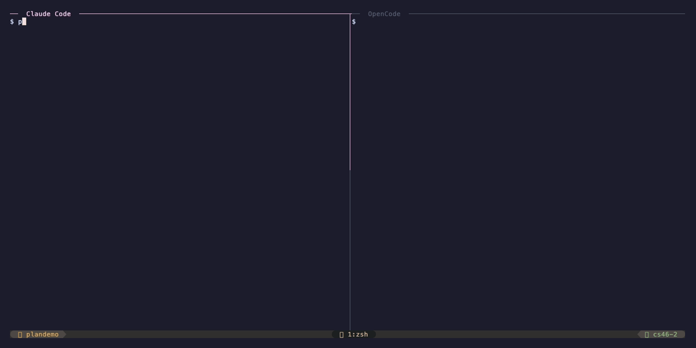

# Bifrost Reference

The [README](../README.md) covers the quick start. This page has the details:
what a snapshot holds, every command, the files Bifrost writes, and the MCP tools.

- [What Gets Captured](#what-gets-captured)
- [Setup](#setup)
- [Usage](#usage)
- [CLI Reference](#cli-reference)
- [Files](#files)
- [MCP Server](#mcp-server)

## What Gets Captured

**Session state** — what you were doing:

| Category          | Example                                                                  |
| ----------------- | ------------------------------------------------------------------------ |
| Current task      | "Implement JWT refresh token rotation"                                   |
| Status            | `[x] validateToken()`, `[x?] refreshToken()`, `[ ] revokeToken()`         |
| Active files      | `src/auth.ts` — middleware stubbed, not wired                            |
| Decisions         | "Using jsonwebtoken not jose — already installed"                        |
| Environment notes | `AUTH_SECRET` must be in `.env`, not `.env.local`                        |
| Next step         | "Write unit tests for validateToken() using pattern from crypto.test.ts" |

**Trust signals** — what tells the next AI what to trust, what to verify first, and what mode to operate in:

| Category       | Example                                                                  |
| -------------- | ------------------------------------------------------------------------ |
| Session intent | `implementing` — plan, implement, debug, or review                       |
| Observed facts | branch, commit, dirty files, active file metadata, project commands       |
| Trust model    | `src/auth.ts` — implementation: medium, tests: low, freshness: current    |
| Evidence       | `npm test` claim backed by a `command_result` Bifrost ran, one the agent reported, or left unverified |
| Assumptions    | "Redis is available on localhost:6379" — unverified                      |
| Open questions | "Should refresh tokens be single-use or reusable across devices?"        |
| Risks          | "Token revocation list not yet implemented"                              |

Current Bifrost versions keep a human-readable `.bifrost/session.md` and can also maintain canonical `.bifrost/session.json` state for validation, verification, evidence anchors, trust dimensions, and diff/timeline operations.

What does **not** get captured: full file contents, conversation history, secrets, long command logs, or generated artifacts. The snapshot is a structured summary of working memory — things in the AI's context that aren't yet in any file.

## Setup

Install the binary with `brew install --cask kogungor/bifrost/bifrost` (the full name matters: plain `bifrost` is an unrelated cask in Homebrew's main repository), the install script, or a release archive; see the [README](../README.md#install).

### 1. Register Commands

This installs `/handoff`, `/handin`, `/plan`, and `/review` for all detected AI tools. Codex has no custom slash commands, so there they install as skills invoked with `$bifrost-handoff`, `$bifrost-handin`, `$bifrost-plan`, and `$bifrost-review`:

```bash
bifrost install
```

To also register Bifrost as an MCP server (recommended — enables richer `/handin` briefings via structured tool calls):

```bash
bifrost install --mcp
```

Without `--mcp`, `/handoff` and `/handin` fall back to writing and reading `.bifrost/session.md` directly; they still work, but MCP gives them structured access to every field. `/plan` and `/review` need the MCP server.

`--mcp` writes each tool's own global config:

| Tool        | Commands                                  | MCP server                                           |
| ----------- | ----------------------------------------- | ---------------------------------------------------- |
| Claude Code | `~/.claude/commands/<name>.md`            | `~/.claude.json` → `mcpServers.bifrost` (user scope) |
| OpenCode    | `~/.config/opencode/commands/<name>.md`   | `~/.config/opencode/opencode.json` → `mcp.bifrost`   |
| Codex       | `~/.agents/skills/bifrost-<name>/SKILL.md` | `~/.codex/config.toml` → `[mcp_servers.bifrost]`     |

OpenCode paths follow `$XDG_CONFIG_HOME` when set. For Codex, `config.toml` follows `$CODEX_HOME`; skills always go to `~/.agents/skills`. Everything else in these files is preserved; the Codex TOML file is only appended to, so its comments stay intact. The tools' own CLIs can register the same server:

```bash
claude mcp add --scope user bifrost -- bifrost mcp-serve
opencode mcp add --global bifrost -- bifrost mcp-serve
codex mcp add bifrost -- bifrost mcp-serve
```

**Upgrading from 1.3.x or earlier:** older versions wrote MCP config to `~/.claude/mcp.json` and `~/.opencode/opencode.json` under an `mcpServers` key. Neither tool reads those entries, so MCP was never active. Run `bifrost install --mcp --force` to register again. `bifrost doctor` then lists the old files so you can remove them.

To install for a specific tool only:

```bash
bifrost install --adapter claude-code
bifrost install --adapter opencode
bifrost install --adapter codex
```

To see what would happen without making changes:

```bash
bifrost install --dry-run
```

Command files change between releases, and `install` keeps files that already exist. After upgrading Bifrost, overwrite them (add `--mcp` and `--hooks` if you use them):

```bash
bifrost install --force
```

### 2. Initialize a Project (optional)

```bash
cd ~/my-project
bifrost init
```

This creates:

- `.bifrost/` directory (gitignored automatically)
- `.bifrost/history/` for archived snapshots
- `BIFROST.md` — a project config file you can commit to git

`BIFROST.md` gives the incoming AI tool persistent project context (stack, conventions, important files, commands). The commands work without it, but the Claude Code hooks act only in projects that have `.bifrost/` or `BIFROST.md`, so run `bifrost init` in any project where you want automatic handoff.

### 3. Verify

```bash
bifrost doctor
```

A healthy output looks like:

```
  Bifrost Doctor

  ✓  Binary               1.5.0
  ✓  Claude Code          commands registered  (/path/to/commands)
  ✓  Claude Code          MCP server registered
  ✓  Claude Code          hooks registered
  ✓  OpenCode             commands registered  (/path/to/commands)
  ✓  OpenCode             MCP server registered
  ✓  Codex                commands registered  (/path/to/skills)
  ✓  Codex                MCP server registered
  ✓  Project              BIFROST.md found
  ✓  Snapshot             22 minutes old
  ✓  Gitignore            .bifrost/ excluded

  All checks passed.
```

## Usage

### Handing Off

In Claude Code or OpenCode, type `/handoff`. In Codex, type `$bifrost-handoff`:

```
/handoff
```

The AI will capture the session state and write it to `.bifrost/session.md`. You'll see:

```
  Snapshot written to .bifrost/session.md
  JSON state written to .bifrost/session.json

  Task    Implement JWT refresh token rotation
  Files   3 active files captured
  Note    auth module half done, JWT middleware needs tests

  Switch to your target tool and run /handin
```

You can add a note:

```
/handoff auth module half done, pick up with the unit tests
```

### Handing In

In your target tool, type:

```
/handin
```

The AI reads the snapshot and presents a briefing:

```
  ─────────────────────────────────────────
   Bifrost Briefing
  ─────────────────────────────────────────

  Project    my-api
  From       claude-code
  Captured   22 minutes ago
  Commit     18270bac
  Intent     implementing
  Pressure   high (previous session was near context limit)
  Verify     warn — inspect changed files before trusting test claims

  Task
  Implement JWT refresh token rotation

  Status
  - [x] validateToken() — verified by `npm test -- auth`
  - [x?] refreshToken() — claimed done, not verified
  - [ ] revokeToken()

  Active files
  - src/auth.ts — implementation=medium tests=medium freshness=current
  - src/tokens.ts — implementation=medium tests=low freshness=stale

  Key decisions
  - Using jsonwebtoken not jose: already installed
  - Refresh tokens in Redis: faster lookup

  Environment notes
  - AUTH_SECRET must be in .env, not .env.local
  - Run with: npm run dev -- --port 3001

  Next step
  Write unit tests for validateToken() using pattern
  from crypto.test.ts. Focus on the expiry edge case.

  Assumptions (not verified)
  - Redis is available on localhost:6379
  - AUTH_SECRET is already set in .env

  Risks
  - Token revocation list not yet implemented

  Verify this first
  - src/tokens.ts changed after handoff
  - npm test status is unverified

  Do not assume
  - Redis is running locally
  - Refresh tokens are single-use
  ─────────────────────────────────────────

  Active plan   auth-refactor
  Status        active
  Health        72/100
  Progress      1 verified, 1 claimed but unverified, 1 blocked
  Next action   Verify claimed step step_003 before marking it done
  ─────────────────────────────────────────

  Open questions — address these before starting:
  - Should refresh tokens be single-use or reusable across devices?

  Ready to continue from here. Any adjustments before we start?
```

The AI waits for your confirmation before starting any work.

For higher-integrity resumes, use:

```
/handin --verify
```

The briefing starts with explicit trust guidance:

```text
Trust this.
- Branch and active file list are current.

Verify this first.
- Test-pass claims are unverified.
- src/tokens.ts changed after the handoff.

Do not assume this.
- Redis availability.
- Refresh token single-use behavior.
```

The same compact briefing is available from the CLI:

```bash
bifrost brief --mode implement --budget 5000
bifrost brief --mode review --full
bifrost brief --json
```

`--budget` is the maximum briefing size in characters (default 5000, roughly 1,200 tokens). Beyond it, lower-priority sections are dropped and listed as omitted; verification warnings and high-severity risks are always kept. `--full` disables the budget.

### Creating Plans

In any AI coding tool, type:

```
/plan auth-refactor
```

The AI creates a structured implementation plan and saves it to `.bifrost/auth-refactor.plan.md`:

```
  Plan written to .bifrost/auth-refactor.plan.md

  Title         Auth token refresh refactor
  Status        draft
  Plan version  v1
  Steps         5 steps defined (0% complete)
  Files         8 files referenced

  Ask another AI tool to run /review to get a critical analysis.
  Consensus required: reviewer must approve before work begins.
```

### Reviewing Plans

Switch to another AI tool and type:

```
/review auth-refactor
```

The reviewer AI analyzes the plan critically (edge cases, security, architecture, missing steps) and submits an explicit outcome:

- **Approved** — plan activates immediately, consensus reached, work can begin
- **Needs revision** — feedback recorded, plan returned to planner

```
  Review complete for .bifrost/auth-refactor.plan.md

  Outcome       needs_revision
  Plan version  v1
  Revision      0 of 3

  Key findings:
  - Token revocation not addressed
  - No rollback strategy for failed migrations

  Planner should run /plan auth-refactor --revise to address feedback.
```

The planner addresses the feedback and re-submits:

```
/plan auth-refactor --revise
```

The reviewer approves in the next round:

```
  Outcome       approved
  Consensus     reached

  Plan is now active. Work can begin.
```



If the review cycle stalls after the maximum number of revisions (default: 3), the planner can override:

```
/plan auth-refactor --force-accept
```

You can also review arbitrary files:

```
/review docs/rfc-auth.md
```

Plans support a full lifecycle: `draft` → `active` → `completed` → `archived`.

Other arguments:

| Command | What it does |
| ------- | ------------ |
| `/plan <name> --next` | Read-only: show the safest next step. |
| `/plan <name> --verify` | Read-only: show plan health and which steps lack evidence. |
| `/plan <name> --revise` | Address review feedback and send the plan back for review. |
| `/plan <name> --force-accept` | Accept a plan that reached the revision limit without consensus. |

A plan's title and goal are fixed once it is written; revisions change its steps.

### Verifying Plan Steps

A plan step can list shell commands that prove it is done. `bifrost plan verify` runs them and records the results as evidence Bifrost observed itself (`collector.command`).

`/plan` writes these commands with each step (the `verify` list of `bifrost_write_plan`), and `/review` checks that they prove the step and are safe to run. In the Markdown plan they appear under the step:

```
- [ ] Add token refresh endpoint
  - id: 3f2a9c1e
  - `internal/auth/refresh.go`
  - verify: `go test ./internal/auth/...`
```

Changing a step's commands with `bifrost_update_plan` resets an approved plan to draft, like any other content change. Results live in `.bifrost/plans/<name>.json`, created the first time `bifrost plan step` or `bifrost plan verify` runs; later edits through the MCP tools keep it in sync, and a step whose commands change loses its old result.

```bash
bifrost plan step auth-refactor step_2 --claimed-done
bifrost plan step auth-refactor step_3 --blocked "waiting on API keys"
```

`plan step` marks a step `claimed_done`, `verified_done` or `blocked` by hand; `bifrost plan next <name>` prints the safest next action.

```bash
bifrost plan status auth-refactor
bifrost plan verify auth-refactor --dry-run   # list the commands only
bifrost plan verify auth-refactor             # list, confirm, then run
```

Plan files are written by AI agents, so the command always lists what it will run and asks first. In a non-interactive shell (for example an agent's tool call) it refuses unless you pass `--yes`. A passing step becomes `verified_done`; a failing one becomes `invalidated` and the command exits with code 2.

### Automatic Handoff (Claude Code Hooks)

```bash
bifrost install --hooks            # all detected tools that support hooks (Claude Code)
bifrost install --adapter claude-code --hooks
```

This adds four hooks to `~/.claude/settings.json`, keeping everything else in the file:

| Claude Code event | Command | What it does |
| ----------------- | ------- | ------------ |
| `PreCompact`  | `bifrost hook pre-compact`  | Reads the session transcript and records the Bash commands that ran in the project, with the exit codes Claude Code recorded, plus files changed with Edit/Write. |
| `PostCompact` | `bifrost hook post-compact` | Saves Claude Code's compaction summary as `.bifrost/handoff.md`, unless the agent wrote its own note during this session. |
| `SessionStart` | `bifrost hook session-start` | On `resume` or `compact`, prints the briefing so Claude Code adds it to context. On `startup`, prints a one-line pointer when a handoff from the last 24 hours exists. |
| `SessionEnd`  | `bifrost hook session-end`  | Same capture as `PreCompact`. |

How captures are written:

- A handoff the agent wrote during this session (for example with `/handoff`) keeps everything it recorded, including its file baseline, so changes made after it still show up in `bifrost verify`. Only the transcript's command results are added.
- A handoff from an earlier session, such as one written in Codex or OpenCode, is never changed. Reading it in Claude Code with `/handin` and leaving does not replace it.
- Otherwise (no snapshot yet, or one an earlier hook wrote) an automatic snapshot is written. It holds only observed facts, lists the files edited this session, and says that no `/handoff` was written. The previous snapshot is archived.
- Commands are recorded as `collector.transcript` evidence, which counts as strong: the exit code comes from Claude Code, not from the model's summary. Only the latest run of each command is kept. Interrupted, backgrounded and timed-out commands, results whose exit code Claude Code reinterpreted (such as `grep` with no match), and denied tool calls are skipped. A command counts as a test run only when it starts a test runner (`go test`, `npm test`, `pytest`, ...), not when it merely mentions a test file. Command text is redacted like other Bifrost state.
- Nothing is written when the session ran no commands and edited no files.
- The `SessionStart` output stays under Claude Code's 10,000-character limit for hook context.

Hooks do nothing in a project without `.bifrost/` or `BIFROST.md`, so installing them user-wide does not touch other repositories. They never fail the session: problems go to stderr and the exit code is always 0. `bifrost doctor` reports whether the hooks are registered.

### Snapshot Freshness

`/handin` always shows the snapshot age. If it's older than 2 hours, a warning is shown. If older than 24 hours, a prominent warning appears. You're never blocked — just informed.

Run a local integrity check before trusting a handoff:

```bash
bifrost verify
bifrost verify --strict
bifrost verify --json
```

`bifrost verify` checks snapshot age, branch and commit drift, active file existence and metadata, evidence-backed claims, unresolved high severity risks/questions, active plan state, and secret-like values in local Bifrost state. It never runs destructive commands.

Evidence records where it came from. Facts Bifrost observed itself (git state, file metadata, commands run by `bifrost plan verify`) use `collector.*` sources and count as strong evidence. Command results the previous agent reported (`reported.command`) count as medium: they are detailed claims, not observations. When a test-pass claim rests only on reported results, `bifrost verify` warns and recommends re-running the tests. Hook captures record commands from the Claude Code transcript as `collector.transcript`, which also counts as strong. MCP callers cannot use `collector.*` sources.

### Secret Redaction

Snapshots, handoff notes and evidence are scanned before they are written, and `bifrost scrub` and `bifrost doctor --security` scan existing state. Detected formats:

- Private key blocks (`-----BEGIN ... PRIVATE KEY-----`)
- Anthropic, OpenAI, Stripe (`sk_`/`rk_`) and Google (`AIza...`) API keys
- GitHub tokens, AWS access keys
- Slack tokens (`xox*`, `xapp`) and Slack webhook URLs
- `Bearer` tokens and JWTs
- Database URLs with embedded credentials
- `*_SECRET`, `*_TOKEN`, `*_KEY` style assignments
- Long random-looking values assigned to `api_key`, `secret`, `token` or `password`

Matches are replaced with a `[REDACTED:<kind>]` marker. Detection is pattern-based, so treat it as a safety net, not a guarantee.

### JSON State, Validation, And Migration

Legacy Markdown snapshots remain readable. Canonical JSON state enables validation and machine-readable workflows:

```bash
bifrost migrate --dry-run
bifrost migrate
bifrost validate
bifrost validate --snapshot .bifrost/session.json
bifrost validate --plan .bifrost/plans/auth-refactor.json
bifrost render --snapshot .bifrost/session.json
```

Validation errors are actionable and use this shape:

```text
Error: invalid snapshot schema
- field: interpretation.status_items[0].state
- value: done
- expected: not_started | in_progress | blocked | claimed_done | verified_done | invalidated

Try:
  bifrost migrate --dry-run
```

### Diff And Timeline

Bifrost can show what changed between the latest archived snapshot and the current snapshot:

```bash
bifrost diff
bifrost diff latest~1..latest
bifrost diff --json
bifrost timeline
bifrost restore 2 --preview
```

Timeline events are local JSON Lines in `.bifrost/timeline.jsonl`. They only store compact metadata such as event type, snapshot ID, plan name, status, and task summary. Secret-like values are redacted before writing.

### Working with BIFROST.md

If `BIFROST.md` exists in your project root, `/handin` loads it and includes project context (stack, conventions, commands) in the briefing. This gives every new session a baseline understanding of the project.

You can analyze and promote durable project context from local facts and snapshots:

```bash
bifrost context check
bifrost context update --dry-run
bifrost context update --accept all
bifrost promote decision --dry-run
bifrost promote --accept prom_1234abcd
```

Promotion is explicit: Bifrost does not overwrite durable project context without an accepted candidate ID or `--accept all`.

Example `BIFROST.md`:

```markdown
---
project: my-api
---

# Project: my-api

## What this is

REST API for the mobile app. Currently in beta.

## Stack

- Node.js 20, Express, PostgreSQL, Redis
- TypeScript, Jest for testing

## Conventions

- All new endpoints need integration tests
- Use zod for request validation
- Error responses follow RFC 7807

## Commands

- `npm run dev` — development server (port 3001)
- `npm test` — full test suite
- `npm run db:migrate` — run pending migrations

## Do not touch

- `src/generated/` — auto-generated from OpenAPI spec
```

## CLI Reference

| Command                               | Description                                      |
| ------------------------------------- | ------------------------------------------------ |
| `bifrost install`                     | Register commands (skills in Codex) for detected AI tools |
| `bifrost install --force`             | Overwrite existing command files after an upgrade |
| `bifrost install --mcp`               | Also register Bifrost as an MCP server           |
| `bifrost install --hooks`             | Register Claude Code hooks for automatic handoff |
| `bifrost hook <event>`                | Run from a hook (hidden): pre-compact, post-compact, session-start, session-end |
| `bifrost init`                        | Initialize Bifrost in the current project        |
| `bifrost status`                      | Show snapshot age, size, intent, and active plan |
| `bifrost export`                      | Export snapshot and/or plans as JSON to stdout   |
| `bifrost validate`                    | Validate snapshot and plan state                 |
| `bifrost migrate --dry-run`           | Preview Markdown-to-JSON migration               |
| `bifrost render`                      | Render JSON v2 state back to Markdown (`-o <file>`) |
| `bifrost snapshot --enrich`           | Collect observed git/file/project facts          |
| `bifrost evidence list`               | List evidence records                            |
| `bifrost evidence show <id>`          | Show one evidence record                         |
| `bifrost verify`                      | Check freshness, evidence, risks, files, secrets |
| `bifrost verify --strict`             | Exit non-zero on warnings too (for CI)           |
| `bifrost brief --mode implement`      | Print compact mode-aware briefing                |
| `bifrost scrub --check`               | Check local Bifrost state for secret-like values |
| `bifrost scrub --write --history`     | Redact secret-like values in local Bifrost state |
| `bifrost plan status <name>`          | Show plan health and step status                 |
| `bifrost plan next <name>`            | Show safest next plan action                     |
| `bifrost plan step <name> <step-id> --claimed-done` | Mark a step by hand (`--verified-done`, `--blocked <reason>`) |
| `bifrost plan verify <name>`          | List plan verification commands, confirm, run them |
| `bifrost plan verify <name> --dry-run` | Only list the commands that would run            |
| `bifrost plan verify <name> --yes`    | Run them without the confirmation prompt         |
| `bifrost context check`               | Analyze durable `BIFROST.md` context (`--json`)  |
| `bifrost context update --dry-run`    | Preview `BIFROST.md` promotion patch             |
| `bifrost promote --accept <id|all>`   | Promote accepted durable context candidates (`--ignore`, `--ignore-forever` to dismiss) |
| `bifrost diff`                        | Compare latest archived and current snapshot     |
| `bifrost timeline`                    | Show local snapshot/verify/plan event timeline (`--limit`) |
| `bifrost history`                     | List archived snapshots (`--limit`)              |
| `bifrost restore <n>`                 | Restore a historical snapshot                    |
| `bifrost restore <n> --preview`       | Preview restore without modifying files          |
| `bifrost doctor`                      | Diagnose installation and configuration          |
| `bifrost doctor --security`           | Check local Bifrost state for secret-like values |
| `bifrost doctor --fix`                | Fix what it can: command files, MCP registration, `.gitignore`, `BIFROST.md` |
| `bifrost update`                      | Show upgrade instructions for the latest release (no self-update) |
| `bifrost update --check`              | Check if a newer version is available            |
| `bifrost version`, `bifrost --version` | Print version                                   |
| `bifrost completion <shell>`          | Generate shell completions (bash, zsh, fish)     |

### Global Flags

| Flag               | Description                          |
| ------------------ | ------------------------------------ |
| `--no-color`       | Disable color output                 |
| `--quiet`          | Print only errors                    |
| `--project <path>` | Override project root auto-detection |

### Exporting State

Export the current snapshot and/or plans as JSON — useful for CI pipelines and scripts:

```bash
bifrost export                    # snapshot JSON (default)
bifrost export --format plans     # all plans as JSON
bifrost export --format all       # snapshot + plans
```

### Snapshot History

Every `/handoff` automatically archives the previous snapshot. History is capped at 50 entries — oldest snapshots are pruned automatically. JSON-backed snapshots are archived too. View, diff, preview, and restore them:

```bash
bifrost history

  Snapshot history — my-api

  #  Timestamp              Age          Source         Task
  ─  ─────────────────────  ───────────  ─────────────  ──────────────────────
  1  2025-03-21 14:32:17    22 min ago   claude-code    auth module half done
  2  2025-03-21 11:18:44    3 hr ago     opencode       database schema finalized
  3  2025-03-20 19:05:31    yesterday    claude-code    initial project setup

bifrost restore 2
bifrost restore 2 --preview
bifrost diff
```

## Files

| Path                                | Purpose                                  | In Git? |
| ----------------------------------- | ---------------------------------------- | ------- |
| `BIFROST.md`                        | Durable project context                  | Yes     |
| `.bifrost/session.md`               | Human-readable active snapshot           | No      |
| `.bifrost/session.json`             | Canonical JSON v2 active snapshot        | No      |
| `.bifrost/handoff.md`               | Freeform handoff note                    | No      |
| `.bifrost/history/`                 | Archived Markdown and JSON snapshots     | No      |
| `.bifrost/evidence/`                | Optional structured evidence records     | No      |
| `.bifrost/plans/<name>.json`        | Plan execution state: step status and verification results (created by `plan step`, `plan verify` or `migrate`) | No      |
| `.bifrost/<name>.plan.md`           | Human-readable implementation plans      | No      |
| `.bifrost/timeline.jsonl`           | Local snapshot/verify/plan event history | No      |
| `.bifrost/config.json`              | Optional local Bifrost runtime config    | No      |

`.bifrost/` is automatically added to `.gitignore`.

## MCP Server

Bifrost can run as an [MCP](https://modelcontextprotocol.io/) server, exposing snapshot and plan operations as formal tool calls over stdio JSON-RPC. AI tools that support MCP can call these tools directly — no slash commands needed.

The server speaks MCP 2026-07-28 (stateless requests with per-request `_meta`, `server/discover`) and the earlier 2024-11-05 through 2025-11-25 revisions through `initialize`, so both current and older clients connect. Every tool carries annotations: read tools are marked read-only, and tools that replace existing content (`bifrost_write_note`, `bifrost_write_plan`, `bifrost_update_plan`, `bifrost_delete_plan`) are marked destructive so clients can ask before calling them. Validation failures come back as tool results with `isError: true`, which the model can read and correct.

Register it:

```bash
bifrost install --mcp
```

This writes config to each adapter's MCP config path: `~/.claude.json` for Claude Code, `~/.config/opencode/opencode.json` for OpenCode, and `~/.codex/config.toml` (`$CODEX_HOME/config.toml`) for Codex. The server runs as a subprocess — no network sockets, no background daemon.

### Snapshot Tools

| Tool                     | Description                                                                                                                                         |
| ------------------------ | --------------------------------------------------------------------------------------------------------------------------------------------------- |
| `bifrost_read_snapshot`  | Read the current session snapshot, including legacy Markdown fields and v2 JSON integrity state when available                                      |
| `bifrost_write_snapshot` | Write a new snapshot with semantic fields, legacy confidence, optional command/manual evidence, collected git facts, and canonical `session.json`    |
| `bifrost_write_note`     | Write a freeform handoff note                                                                                                                       |
| `bifrost_status`         | Quick status: snapshot age, session intent, active plan, open question count, history count                                                         |

### Plan Tools

| Tool                  | Description                                                        |
| --------------------- | ------------------------------------------------------------------ |
| `bifrost_read_plan`   | Read a named plan (default: "plan")                                |
| `bifrost_write_plan`  | Create or overwrite a plan with title, goal, steps (with files and verification commands), and constraints |
| `bifrost_update_plan` | Add review notes, update step status, content and verification commands, change plan status |
| `bifrost_delete_plan` | Delete a named plan                                                |
| `bifrost_list_plans`  | List all plans with name, status, title, and completion %          |
